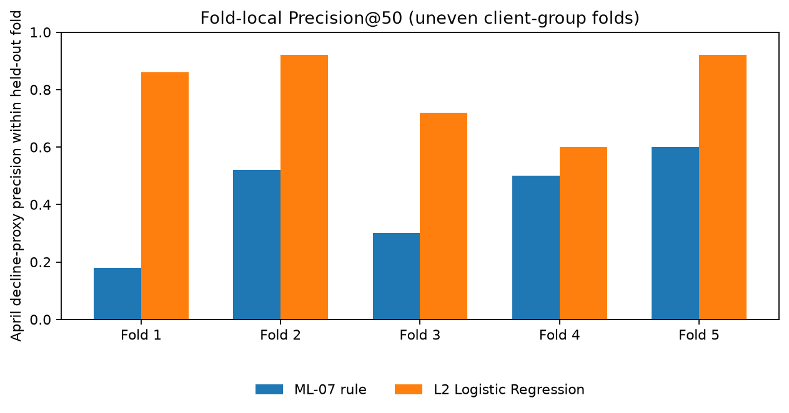
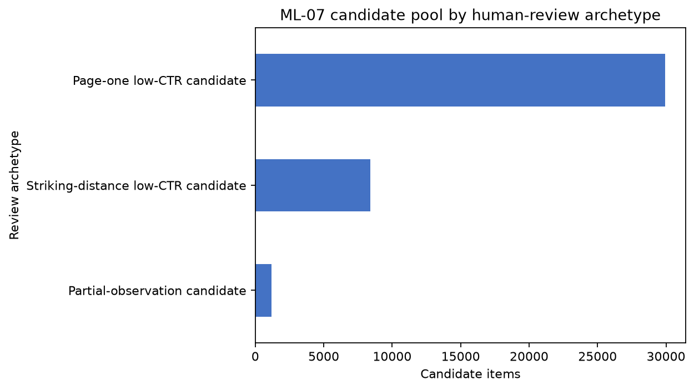

# Search Intelligence Capstone: Content Opportunity Scoring

**I built a retrospective ranking workflow to help editorial teams decide which eligible search-content items to inspect first.** This is my Lane 2 project for the FlyRank Machine Learning Internship, using its gated search warehouse and a client-grouped evaluation.

> **Headline result:** Within this selected March/April cohort, the L2 Logistic Regression ranked April impression-decline proxy cases ahead of the specified ML-07 rule in all five client-grouped folds. Fold-macro Precision@50 was **0.804 vs. 0.420** (a 0.384 absolute difference); macro ROC-AUC was **0.636 vs. 0.438**, and average precision was **0.655 vs. 0.501**. These are descriptive fold-local results against this particular baseline, not proof that machine learning universally beats rules.

**Read the [deployed research paper](https://divyam-chauhan.github.io/FL_Machine_learning/)** · [Explore the capstone notebook](work/notebooks/capstone.ipynb) · [Read the aggregate report](work/capstone_report.md) · [Connect on LinkedIn](https://www.linkedin.com/in/divyamchauhan2/)

## The decision I studied

FlyRank’s Lane 2 asks how search signals can help prioritize content for review. I focused on high-impression, low-CTR page-client items: which ones should a person inspect first for snippet fit, query-page fit, measurement coverage, or internal discovery?

The ranking is **decision support for human review**. It does not diagnose stale pages, determine that a page needs a refresh, or estimate what an edit will do to traffic.

## How I approached it

1. **Frame the review decision.** Define the intended action as prioritizing eligible items for inspection, not automating edits.
2. **Set the data contract.** Aggregate the daily warehouse table to one page-client pair per month; require at least 20 GSC-available days in both months and positive March impressions.
3. **Define the comparison.** Select the ML-07 candidate pool and label an item positive when April impressions are at most 80% of March impressions.
4. **Build a transparent baseline.** Rank candidates by `log1p(March impressions)`, with March clicks and average position as tie-breakers.
5. **Train and validate.** Fit L2 Logistic Regression on March-only features and compare model and rule within five client-grouped held-out folds.
6. **Turn results into review prompts.** Use the W07 action playbook to suggest what a human should inspect first; keep the queue itself out of this public repo view.

## Data and model

The source is the gated [FlyRank/internship-warehouse](https://huggingface.co/datasets/FlyRank/internship-warehouse), release/build **v20260703**, table `fact_content_daily_performance`. The analysis uses March 2026 features and April 2026 outcomes, aggregated to a page-client pair. The paired cohort contains **95,633** items after the coverage and positive-March-impression filters.

The ML-07 gate selects **39,545 candidates across 31 client groups** with at least 500 March impressions, average position above 0 and at most 20, and CTR below 0.5%. The measured outcome is the retrospective decline proxy: April impressions ≤ 80% of March impressions. It is not a refresh-success label.

The model uses five March-only inputs: log impressions, log clicks, CTR, average position, and GSC-available days. Client and content IDs are used only for joins and client grouping, never as predictors. The W07 evaluation uses five-fold `GroupKFold` by client. Because each fold has its own fitted model, I report ranking and metrics within each held-out fold rather than treating scores from separate folds as one comparable pooled ranking.

**Decision-time limitation:** April GSC coverage is required to define the evaluated cohort. April is not a model feature, so this is not input leakage; however, exact cohort membership could not have been selected at a March-time decision point. This is one retrospective adjacent-month cohort, not a live March queue or an early-warning test. Two folds hold out one client each and fold sizes vary, so the macro metrics are descriptive rather than confidence intervals.

## What the evaluation showed

| Fold-macro metric | Logistic Regression | ML-07 rule |
|---|---:|---:|
| Precision@50 | **0.804** | 0.420 |
| ROC-AUC | **0.636** | 0.438 |
| Average precision | **0.655** | 0.501 |

The model’s fold-local Precision@50 exceeded the rule’s in all five folds. This is a strong result against this specified rule on this selected retrospective cohort; it does not establish performance on future cohorts, causal refresh impact, or guaranteed traffic recovery. The score is not calibrated confidence or expected refresh lift.

### Fold-local Precision@50

*Each bar is computed within its held-out fold. The chart shows the consistent direction across these five partitions; it does not pool scores across folds or quantify future-cohort uncertainty.*

### W07 review archetypes

*These are rule-defined review groups, not learned quality classes or evidence that a refresh is needed.*

## Ranked human-review recommendations

1. **Verify observation coverage before editing** for the **1,201** partial-observation candidates. Check that the page and GSC measurements are current; sparse observation is not itself a content problem.
2. **Review snippet and search intent** for the **29,932** page-one, low-CTR candidates. Inspect the query mix, search-result context, title/snippet fit, and factual accuracy before considering a change.
3. **Review query-page fit and internal links** for the **8,412** striking-distance, low-CTR candidates. Check intent alignment and internal discovery context before deciding whether an edit is appropriate.

These counts describe W07’s aggregate action archetypes. They are prompts for a human reviewer, not validated refresh actions or predicted outcomes.

## Follow the project work

The notebooks show how I moved from the assignment question to a checked, evaluated, and actionable analysis:

| Step | Notebook(s) | Purpose |
|---|---|---|
| Frame the question | [W01](work/notebooks/w01_research_question.ipynb), [W02](work/notebooks/w02_ml_task_framing.ipynb) | Choose the lane and define the decision to support. |
| Define and check the data | [W03 contract](work/notebooks/w03_data_contract.ipynb), [W03 leakage check](work/notebooks/w03_feature_leakage_check.ipynb) | Establish the warehouse grain, cohort, and safe features. |
| Audit signals and set a rule baseline | [W04 signal audit](work/notebooks/w04_signal_audit.ipynb), [W04 baseline](work/notebooks/w04_baseline_score.ipynb) | Assess candidate signals and specify the transparent comparison. |
| Train and validate | [W05 model](work/notebooks/w05_model.ipynb), [W06 validation audit](work/notebooks/w06_validation_audit.ipynb) | Fit the model and examine held-out client performance. |
| Build the action playbook | [W07 action playbook](work/notebooks/w07_action_playbook.ipynb) | Turn aggregate patterns into ranked review prompts. |
| Reproduce the capstone | [Capstone notebook](work/notebooks/capstone.ipynb), [capstone report](work/capstone_report.md) | Reconstruct the paired cohort, fold-local results, and safe figures. |

### Reproducibility and data safety

The capstone notebook was executed with **Python 3.11.9** (seed 42). Re-running it requires approved access to the gated warehouse and a local Hugging Face token read from the ignored `.env`; credentials are not part of this repository. The row-level action queue contains pseudonymous join keys and is for controlled internal use, so it is not linked or reproduced here. Public figures and results are aggregate only.

For internship setup and repository conventions, see [`SETUP.md`](SETUP.md), [`DATA_USE.md`](DATA_USE.md), and [`work/README.md`](work/README.md). The deployed paper contains the full methodology, fold table, limitations, and references.

## Acknowledgments

**[Built on the FlyRank ML Internship dataset](https://flyrank.ai/).** Thanks to FlyRank for the internship program and access to the gated warehouse. The assigned March 2026 FlyRank SEO research paper is background context; its portfolio findings are not results from my model.
